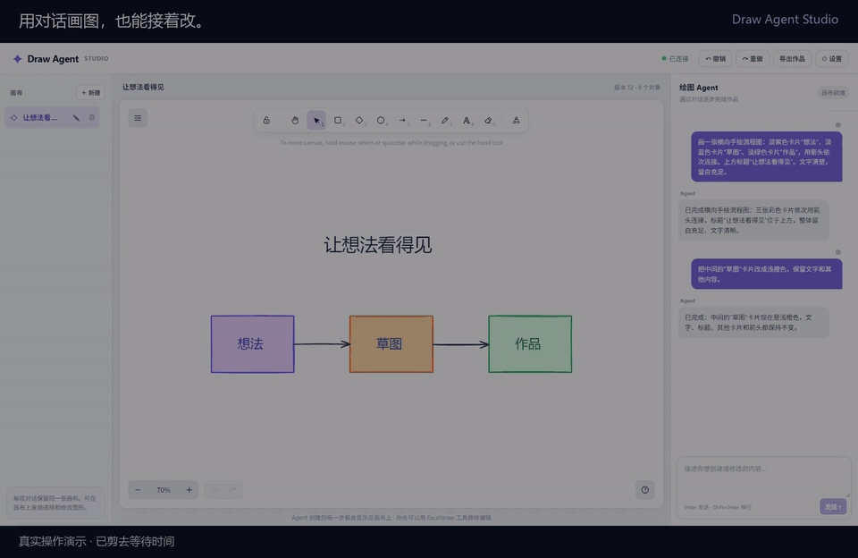

# Draw Agent Studio

**用对话画图，也能接着改。**

描述你的想法，看着画面逐笔出现；接着说“移到右边”“改成蓝色”，在同一张画布上继续完成作品。

An open-source AI drawing app. Draw with words, refine through conversation, and export editable artwork.

[](docs/assets/demo.mp4)

[观看演示视频（37 秒）](docs/assets/demo.mp4) · [快速启动](#快速启动) · [反馈问题](https://github.com/bugkeep/ai-draw/issues)

演示使用真实模型，已剪去等待时间；动态预览使用 2 倍播放速度。

## 可以做什么

- **描述画面**：通过自然语言创建草图、插画和流程图，观看绘制过程。
- **接着修改**：移动、改色、删除、撤销和重做，连续调整同一幅作品。
- **直接动手**：随时使用 Excalidraw 的选择、拖动、画笔和文字工具编辑。
- **保存与导出**：自动保存多张画布，支持 PNG、JPG、WebP、SVG 和可继续编辑的 Excalidraw 文件。

## 快速启动

准备 **Python 3.11+** 和 **Node.js 20.19+**。Windows 还需要安装 Chrome。

```bash
git clone https://github.com/bugkeep/ai-draw.git
cd ai-draw
python -m pip install -r requirements.txt
cd frontend-app
npm ci
npm run build
npx playwright install --with-deps chromium
cd ..
python run.py
```

打开 [http://127.0.0.1:8000](http://127.0.0.1:8000)，点击右上角 **设置**：

1. 选择模型厂商，填写模型名称、API 地址和 API Key。
2. 使用支持 **图片输入和工具调用** 的模型，点击 **测试连接**。
3. 测试通过后 **保存配置**，返回画布开始绘图。

可选择 Ark、OpenAI、Claude、Gemini 等厂商，也可接入本地服务或自定义兼容接口。各模型的可用能力以连接测试为准，模型服务按所选厂商计费。[查看模型配置说明](docs/model-settings.md)

以后在项目目录运行 `python run.py` 即可启动。

## 试着这样说

```text
画一个蓝色圆形，名字叫主圆
把它向右移动 80 像素
把它改成红色
撤销
```

也可以输入“用画笔画一张笑脸，展示作画过程”，或者描述一幅你想画的场景。完成后点击 **导出作品**，保存图片或继续编辑的文件。

## 反馈与参与

欢迎在 [Issues](https://github.com/bugkeep/ai-draw/issues) 分享作品、提出想法或反馈问题。觉得有用的话，欢迎点亮 Star，让更多人看到这个项目。

[部署说明](docs/deployment.md) · [参与贡献](CONTRIBUTING.md) · [开发与验证](docs/development.md) · [MIT License](LICENSE)
