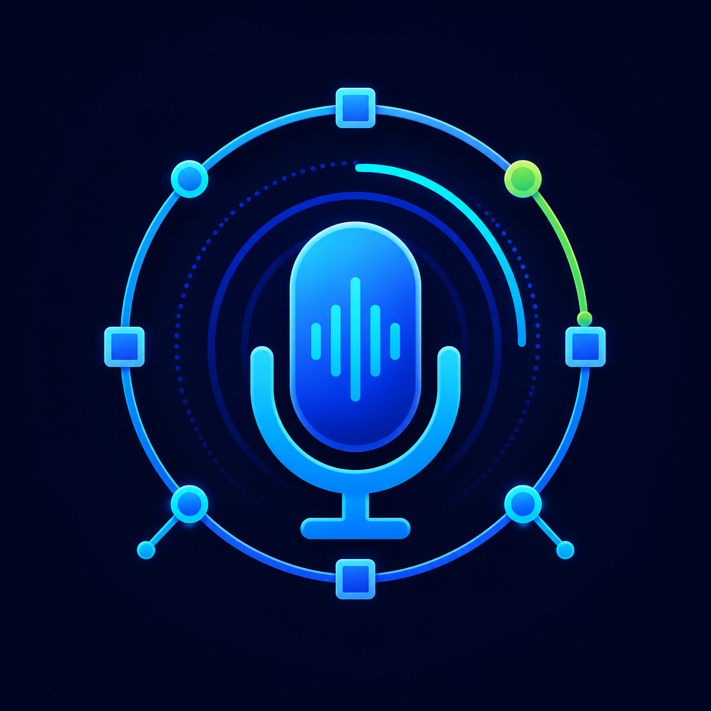
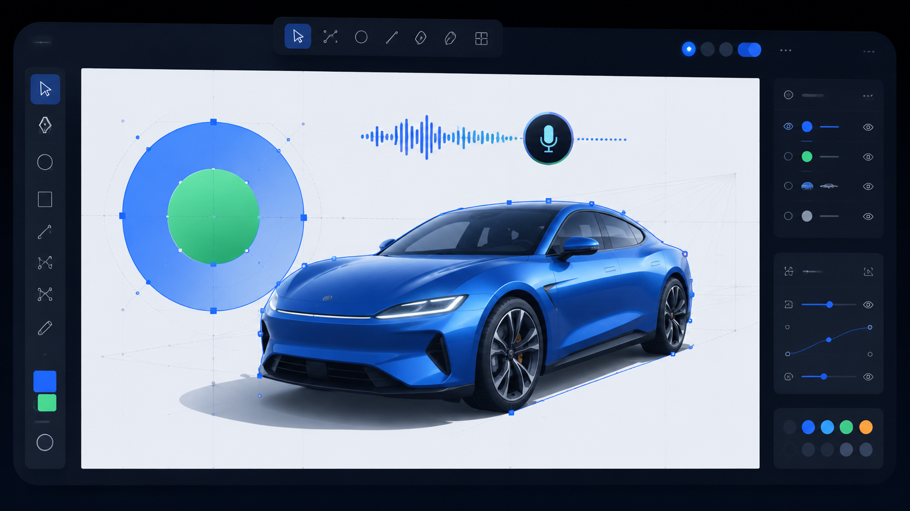

<p align="center">
  
</p>

<h1 align="center">AI Voice Draw</h1>

<p align="center">
  通过语音完成可编辑矢量绘图、对象修改和画布控制。
</p>

<p align="center">
  Demo 视频：<a href="https://www.bilibili.com/video/BV1svJK6GE4W/?vd_source=723ddfb3af0423938c7cbf34281dc056">Bilibili BV1svJK6GE4W</a>
</p>



AI Voice Draw 是一个纯语音优先的 AI 绘图应用。项目目标是让用户尽量不依赖鼠标、键盘和复杂工具栏，仅通过自然语言语音指令完成绘图、编辑、撤销、重做、清空、导出和连续补充创作。

这个项目重点解决两个问题：一是传统绘图软件操作门槛高，二是很多 AI 绘图工具虽然能一次生成图片，但难以按用户后续指令做精细、可编辑的修改。因此本项目把语音理解、可编辑矢量操作、低延迟本地控制和操作结果语音反馈作为核心能力。

完整的指令能力、实现状态和未完成原因见：[docs/command-capabilities.md](docs/command-capabilities.md)。

## 核心能力

- 语音绘制：支持圆形、矩形、直线、椭圆、多边形、折线、路径、文字、同心圆、分层矢量构图和结构化透视车辆。
- 语音编辑：支持移动、缩放、旋转、翻转、镜像、倾斜、对齐、均匀分布、复制、删除、成组、取消成组、裁剪、改色、透明度、描边、纯色填充、渐变填充和样式复制。
- 语音选择：支持按对象、类型、颜色、最后对象、矩形区域、椭圆区域、套索区域和相似对象选择。
- 简单指令专用处理：例如“画同心圆，最里面绿色，外层蓝色”会走同心圆工具，避免误画成两个无关圆。
- 复杂结构绘图：当用户要求“3D”“立体”“透视”“正常结构”时，会进入更复杂的矢量构图路径，不退化成普通二维图标。
- 低延迟本地命令：撤销、重做、清空确认、停止当前绘图、重试、导出画布等高频控制不需要等待完整模型调用。
- 连续语音队列：模型处理上一条绘图请求时，后续语音指令仍可进入队列，避免丢失用户输入。
- 语音反馈：操作成功、失败、耗时和错误恢复提示会通过浏览器 TTS 播报。
- 指令能力公告：前端提供首次弹窗和页眉入口，集中说明当前支持的语音指令能力。
- 素材工作流：后端工具层支持矢量素材搜索、导入、替换和候选列表。

## 架构概览

```text
浏览器
  -> Web Speech API 持续语音识别
  -> 语音文本标准化与本地命令路由
  -> Vue + Fabric.js 画布
  -> FastAPI HTTP / WebSocket 服务
  -> 本地 TCP Agent daemon
  -> AgentRunner + ToolRegistry
  -> OpenAI 兼容或 Bailian 模型 Provider
  -> 返回 Fabric.js 操作代码给前端执行
  -> SpeechSynthesis 语音反馈
```

前端负责语音输入、画布展示、低延迟本地操作和执行返回的 Fabric.js 代码。后端负责模型路由、工具调用规划、事件追踪、素材接口和 daemon 通信。

## 第三方框架与库

本项目使用了以下第三方框架、库或外部能力。评审时如需检查依赖来源，可从 `requirements.txt` 和 `frontend-app/package.json` 对照。

### 前端

- [Vue 3](https://vuejs.org/)：浏览器端 UI 框架。
- [Vite](https://vite.dev/)：前端开发服务器和生产构建工具。
- [Fabric.js](http://fabricjs.com/)：对象化 Canvas 绘图、选择和编辑能力。
- `@vitejs/plugin-vue`：Vite 的 Vue 单文件组件插件。
- `vite-plugin-vue-devtools`：Vue + Vite 开发调试工具。

### 后端

- [FastAPI](https://fastapi.tiangolo.com/)：HTTP API 和 WebSocket 应用框架。
- [Uvicorn](https://www.uvicorn.org/)：运行 FastAPI 的 ASGI 服务器。
- [OpenAI Python SDK](https://github.com/openai/openai-python)：OpenAI 兼容模型 Provider 客户端。

### 浏览器原生能力

- Web Speech API `SpeechRecognition`：浏览器语音识别。
- Web Speech API `SpeechSynthesis`：浏览器语音播报。

### 外部服务

- OpenAI 兼容模型服务：通过 OpenAI 格式调用。
- Bailian / DashScope：通过 `DASHSCOPE_API_KEY` 和 `BAILIAN_MODEL` 调用。
- Iconify SVG 素材：通过内置白名单素材 Provider 获取矢量资源。

## 项目结构

```text
agent/            Agent runner、daemon、session、路由、prompt 和重试逻辑
assets/           矢量素材 provider、搜索、缓存、元数据和 SVG 安全清洗
core/             事件记录、trace、run/session handler
events/           EventBus、广播、诊断和订阅
frontend-app/     Vue + Vite 前端源码
frontend-dist/    构建后的前端产物，存在时由 FastAPI 托管
mcp/              MCP bridge、client、manager 和示例
protocol/         JSON-RPC 协议、队列、心跳和 session 模型
providers/        OpenAI、Bailian 和 tracing provider
server/           FastAPI 应用、API 路由、素材路由和安全校验
skills/           本地 skill 定义和加载器
tests/            Python 单元测试与集成测试
tools/            绘图、编辑、历史、素材和执行工具
docs/             产品设计和实现文档
```

## 环境要求

- Python 3.11 或更新版本。
- Node.js `^20.19.0` 或 `>=22.12.0`，与前端 `package.json` 的 engines 要求一致。
- 推荐使用 Chromium 系浏览器，因为不同浏览器的语音识别支持差异较大。
- 至少配置一种模型服务：
  - `OPENAI_API_KEY`，用于 OpenAI 兼容模型；
  - 或 `DASHSCOPE_API_KEY`，用于 Bailian / DashScope。

## 配置

在项目根目录创建本地 `.env` 文件。不要提交真实 API Key。

Bailian / DashScope 示例：

```env
LLM_PROVIDER=bailian
DASHSCOPE_API_KEY=your_dashscope_key
BAILIAN_MODEL=qwen-plus
```

OpenAI 兼容模型示例：

```env
LLM_PROVIDER=openai
OPENAI_API_KEY=your_openai_key
OPENAI_MODEL=gpt-4o
```

如果没有显式设置 `LLM_PROVIDER`，但存在 `DASHSCOPE_API_KEY`，服务端会自动选择 Bailian；否则默认使用 OpenAI。

前端设置面板也可以临时覆盖 Provider、模型和 API Key。前端输入的 API Key 只保存在当前浏览器 session storage 中，不写入仓库。

## 本地运行

从项目根目录执行：

```bash
python -m pip install -r requirements.txt
cd frontend-app
npm install
npm run build
cd ..
python run.py
```

浏览器打开：

```text
http://localhost:8000
```

如果只调试前端，可以运行：

```bash
cd frontend-app
npm run dev
```

## 示例语音指令

- “画一个红色圆”
- “画同心圆，最里面是绿色，外层是蓝色”
- “将这个正方形右转45度”
- “画一辆有正常3D结构的汽车”
- “把最后一个对象改成半透明”
- “选中红色圆”
- “三个图形横向均匀分布”
- “撤销”
- “重做”
- “停止当前绘图”
- “导出当前画布为 PNG”

> [!NOTE]
> 浏览器首次麦克风授权必须由用户手动确认，这是浏览器安全策略限制，页面无法绕过。授权完成后，创作流程可以继续通过语音完成。

## 测试

运行 Python 测试：

```bash
python -m pytest -q
```

运行前端测试：

```bash
cd frontend-app
npm test
```

构建前端：

```bash
cd frontend-app
npm run build
```

可选 Python 语法检查：

```bash
python -m compileall agent server tests -q
```

## 当前限制

- 当前重点是可编辑矢量和 Fabric.js 画布操作，不是写实照片级文生图。
- 不同 Chromium 版本对 SpeechRecognition 的实现和置信度字段支持不完全一致。
- “停止当前绘图”已经能阻止前端应用过期结果，但后端运行资源的完整取消仍依赖后续异步任务协议完善。
- 真实光栅画笔、像素橡皮、克隆图章、修复、液化、复杂滤镜链和精确路径布尔重算仍属于后续能力。

## 相关文档

- 指令能力设计与实现记录：[docs/command-capabilities.md](docs/command-capabilities.md)
- 产品设计与实现记录：[docs/voice-first-product-design.md](docs/voice-first-product-design.md)
- 架构设计文档：[docs/design.md](docs/design.md)
