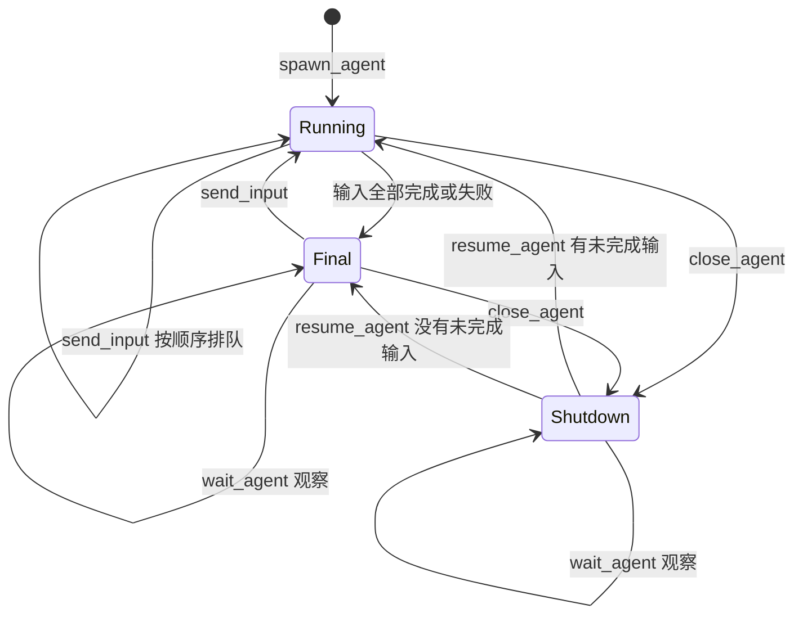

# 子 Agent 生命周期

主 Agent 通过模型原生 function calling 调用 `spawn_agent`、`send_input`、`wait_agent`、`close_agent` 和 `resume_agent`。runtime 执行每次调用，将结果关联到原来的 `call_id`，再交回主 Agent。各厂商的工具消息格式由模型请求模块转换。

## 编号和归属

| 字段 | 含义 |
| --- | --- |
| `session_id` | 用户的画布会话，拥有独立文档、对话和 Agent |
| `task_id` | 用户某条对话指令的执行任务 |
| `agent_id` | 可跨多条指令复用的子 Agent 会话 |
| `input_id` | 派发给某个子 Agent 的一条输入 |
| `run_id` | 该输入的执行记录，关闭和恢复沿用这个编号 |
| `call_id` | 一次模型工具调用；对应一个结构化返回 |
| `result_id` | 保存的绘图结果，供主 Agent 审核、提交或拒绝 |

每个子 Agent 只属于一个画布会话。输入、执行记录和绘图结果都会检查归属，其他画布不能引用这些编号。主 Agent 与子 Agent 使用本次任务开始时的同一份模型配置和 API Key，消息及上下文分别管理。

## 工具

| 工具 | 参数 | 行为 |
| --- | --- | --- |
| `spawn_agent` | `message`、可选 `nickname`、`relevant_ids` | 创建子 Agent，立即开始执行，返回身份、状态、输入和执行编号 |
| `send_input` | `agent_id`、`message`、可选 `relevant_ids` | 复用原会话；运行期间的新输入按到达顺序排队 |
| `wait_agent` | `ids`、可选 `after` | 等待任意指定 Agent 完成一次执行，或观察到 Final/Shutdown；返回摘要、结果编号和状态版本 |
| `close_agent` | `agent_id` | 停止执行，保留上下文、排队输入、工具检查点和已准备动作 |
| `resume_agent` | `agent_id` | 使用原身份恢复未完成工作；没有待处理输入时进入 Final |
| `view_agent_result` | `result_id`、可选 `region` | 将未提交动作重放到当前共享画布，返回候选 PNG，可放大指定区域；画布和提交进度保持原样 |
| `apply_agent_result` | `result_id` | 主 Agent 查看当前候选图后接受结果，执行器依次提交尚未提交的动作 |
| `reject_agent_result` | `result_id`、`reason` | 主 Agent 拒绝未提交部分，并保存原因；已提交内容保留在画布 |

子 Agent 具有 `draw_paths`、`reshape_path`、`create_elements`、`create_element`、`select_elements`、`move_elements`、`update_elements`、`delete_elements`、`inspect_scene` 与本轮完成信号 `finish_drawing`。工具名称与参数在每次执行前校验，子 Agent 无法创建或控制其他 Agent。

每轮主 Agent 上下文默认附上一份可提交结果的候选图片。图片根据最新共享画布和该结果的剩余动作生成，保留其他 Agent 或用户后来增加的图形，并在绘制前检查全部目标及依赖。主 Agent 可以提交该结果、用 `view_agent_result` 查看另一个结果或局部图片，或通过 `reject_agent_result` 退回有问题的结果。

候选图片保存在 `canvas_observations`，`scope=proposed_result`，与当前共享画布、子 Agent 私有草稿分别标记。实际模型响应成功后记录图片已经发送；主 Agent 尚未收到对应候选全图时不能提交。画布变化或部分动作已经提交后，剩余动作需要重新预览。删除全部对象的候选也需要查看空白画布。每轮默认保留一份候选，完整历史图片继续保存在 SQLite。

主 Agent 与子 Agent 均可使用 `search_references` 和 `read_reference` 读取免费的公共绘图资料。研究子 Agent 可以只返回方案和来源，不准备画布动作；主 Agent 审核方案后安排绘图。检索结果和网页正文保存在所属任务的 SQLite 工具记录中，只有短片段和编号进入当前 Agent 上下文，其他画布不能读取这些来源。工具参数与筛选方法见[绘图工具与资料检索](drawing-tools.md)。

画布概况保留近期对象和选择状态。`inspect_scene` 支持按 `ids`、名称文字与画布区域分页读取当前对象，因此较早的图形可以继续被定位和修改。`include_geometry=true` 将完整点列保存到原始结果，当前上下文继续使用结构化元数据；精确点列通过 `recall_memory` 按对象分页取回，再交给 `reshape_path`。

`finish_drawing` 的 `summary` 是完成后的简短说明。该工具应位于本轮全部绘图工具之后；前面的任何工具失败，都会返回对应的 `function_call_output` 并要求 Agent 读取错误后继续处理。主 Agent 仍有运行工作或待处理结果时，完成信号也会返回错误。成功的完成信号允许省去一轮仅返回文本的模型调用。

子 Agent 的草稿在完成当前输入前经过独立图片复查。`DraftReview` 使用同一模型连接、独立且无绘图工具的上下文，检查当前输入的完成标准、开始时的私有草稿、当前全图、所需局部图和该子 Agent 实际查看的参考图。检查只针对本次输入及新增损坏；构图阶段可以留待后续补充五官，局部修改无需修复无关旧内容。返回包含 `ready`、`repair` 或 `blocked`、可见依据、具体缺陷、当前对象编号和下一步建议。子 Agent 的大量历史工具记录不进入复查请求。

首批实际修改保存后，在下一次子 Agent 决策前进行复查；同一次模型回复中的工具继续按顺序执行，复查观察整批结果。纯规划、只读查询和初始选择操作不启动图片检查。已经收到意见的草稿再次改变时使用新意见；当前内容不变时复用缓存。同一私有草稿重复读取相同证据，且此前证据已经实际进入模型上下文时，也会触发复查。未读工具错误优先返回子 Agent。复查意见按当前输入、草稿内容、选择、参考图片和模型配置缓存；仅切换草稿放大区域继续复用意见。模型收到反馈后可以擦除、重画或重新定位具体对象，工具调用继续正常执行。

纠错时附上缺陷涉及的当前对象与局部图片，已经读过的工具过程继续保存在 SQLite，近期上下文侧重当前需要修改的内容。修正动作保存后自动复查，再决定继续修正或交付本次输入。发现未读错误时，先让子 Agent 读取完整错误，再继续复查。

新的有效评审首次送达前，harness 才建立这次修复的上下文检查点。复用已经送达的同一评审时，不再重复清空成功查询和修复过程；对象检查与后续参考图查看之间仍可保留需要的事实。近期重复查询继续合并，完整记录继续留在 SQLite，未读工具错误始终完整进入下一次真实模型请求。

发生实际图形变化后，复查可比较同一输入中上一份已经送达的草稿与当前草稿，并返回 `revision`。`change` 区分 `preparation`、`improved`、`ineffective` 和 `regressed`；无效修正或退步需要给出不同的 `next_strategy`。上一份图片及少量动作类型、对象名称进入检查请求，长参数和几何继续留在 SQLite。比较只使用本次运行的完整草稿图片，当前对象编号会重新核对。

仅删除或擦除旧线条时继续准备绘图。存在新绘制、重塑、移动等实际修正，且独立图片判断为无效或退步时，runtime 将本次输入交回主 Agent：执行进入 Final，`completion.status="blocked"`、`reason="ineffective_repair"`、`stopped_by="runtime_visual_review"`，同时保存原动作、具体问题与下一种方法。该转换根据图片和动作语义判断，不设置调用次数或时间期限。存在未读工具错误时先完整送达，再交回。

主 Agent 从结果 JSON 读取问题与下一种方法，审阅候选，调整参考证据、当前阶段或具体部位，再复用原子 Agent 或安排新工作。`model_context.replan_run_ids` 从实际发送的主 Agent 上下文提取，记录哪些未完成交回已经进入模型请求。主 Agent 保留整幅作品的目标与待办事项，当前阶段结束不代表整幅作品通过。

同一份候选只有局部需要修正时，调度流程应保留待提交结果，使用 `send_input` 给原子 Agent 指派一个具体部位。下一条私有草稿继承该 Agent 尚未提交的结果，继续使用原对象编号，并记录提交依赖。主 Agent 审阅修正后的组合，按依赖顺序提交。`reject_agent_result` 放弃该结果的全部剩余动作；拒绝后的结果不会进入后续输入的起始草稿，因此该工具用于放弃整份候选。

子 Agent 使用 `finish_drawing({"summary":"…","completion_status":"ready"})` 请求完成本次输入，省略 `completion_status` 时同样按 `ready` 处理。图片复查不通过时，真实工具返回携带完整问题，要求下一轮读取并修正。确实缺少前置条件或输入要求冲突时，子 Agent 在读取当前复查后可以使用 `completion_status="blocked"` 和非空 `unresolved` 数组交回未完成工作。该输入进入 Final，其结果保留已准备动作，并附 `completion.status="blocked"`；主 Agent 需要处理阻碍、调整输入或安排修正，并继续审阅候选图片。执行结束不等于绘画通过。

`draft_review_baselines` 保存每条输入实际开始时的私有草稿，包括前序尚未提交的依赖结果。`draft_reviews` 保存复查、对应图片和发送状态，`agent_completion_notes` 保存完成或阻碍说明。关闭恢复保留这些记录；主 Agent 的整幅画质量检查与共享画布提交仍按原流程执行。纯资料研究输入没有绘图动作时不增加草稿复查请求。

调用与返回记录示例：

```json
{
  "type": "function_call",
  "call_id": "call_x",
  "name": "spawn_agent",
  "arguments": "{\"message\":\"绘制左侧房屋\",\"nickname\":\"Hypatia\"}"
}
```

```json
{
  "type": "function_call_output",
  "call_id": "call_x",
  "output": "{\"agent_id\":\"agent_123\",\"nickname\":\"Hypatia\",\"state\":\"Running\",\"input_id\":\"input_456\",\"run_id\":\"run_789\"}"
}
```

同一个调用编号和相同参数重复送达时，返回已保存的结果。创建和输入编号根据调用编号生成，执行中断后重新处理也不会重复创建 Agent 或重复添加输入。相同调用编号携带不同参数会直接报错。

## 状态和排队



单个 Agent 只有一个执行协程，输入按数据库插入顺序处理。不同 Agent 的模型请求可以同时执行。`Final` 表示当前输入已处理，具体成功或失败由执行记录的 `status` 和 `error` 表示。

`wait_agent` 不会创建、恢复或重新执行任何工作。`after` 是各 Agent 上次返回的状态版本，用于读取新完成的执行结果。处于 Final 或 Shutdown 的 Agent 始终可以立即返回；继续等待其他工作时，使用返回的 `running_ids`，并仅携带这些编号对应的状态版本。

主 Agent 可以在一个结果完成后立即审核并提交，其余 Agent 继续准备。主 Agent 回复最终内容前，runtime 检查是否还有本任务的运行工作或待审核结果。运行工作需要完成或关闭，结果需要提交或明确拒绝。

完成调度由同一个入口处理普通回复和 `finish_drawing`。有画布修改、选择修改、绘图工具尝试或私有绘图动作时，沿用独立图片评审。起始与当前画布一致且没有绘图工作时，harness 检查原始要求、拟发送的文字、当前图片及本任务实际结果：说明、状态和报告请求可以通过文字检查完成；任何绘图或混合请求仍转入原有图片评审。文字检查不会把旧的图片评审改成通过。

文字检查使用当前任务、画布、回复内容、证据和模型配置生成缓存标识，修改回复后重新检查。格式错误完整返回后续上下文，并在再次检查时交给评审模型修正格式。完成前再次核对画布与子 Agent 状态；评审期间画布变化时要求检查当前内容。

原生参考描线的同一计划可以跨多个工具分页准备。最近一次成功描线返回有效且连续的 `next_page` 时，自动草稿复查等待该计划的最后一页；每轮实际草稿图片与工具返回仍交给子 Agent。最后一页、显式完成、其他修改或重复读取继续触发原有检查，工具错误照常进入下一轮上下文。

## 私有上下文与绘图结果

SQLite 保存完整模型返回、工具参数、工具输出、私有画布和执行检查点。子 Agent 的下一轮上下文包括当前目标、前一次工作摘要、当前私有画布概况和近期完整工具交换。近期交换使用 48,000 字符的历史预算，较早的完整记录保存在数据库。

主 Agent 的每轮上下文包括最近对话、当前共享画布概况、本任务子 Agent 状态和结果摘要。同一画布其他任务的子 Agent 以 `available_child_agents` 提供编号、名称和状态，供主 Agent 显式复用；其历史执行结果不会自动作为当前任务的结果加入上下文。`task_progress` 从 SQLite 读取本任务已经派发的输入、已提交结果、拒绝原因和提交数量，保留准确的输入与结果编号。子 Agent 的画笔点列、完整动作列表和工具记录由 `result_id` 引用，提交时从 SQLite 读取。

主 Agent 自己的工具交换按完整的调用与返回保留在近期上下文，超过 48,000 字符的历史预算后移除较早的完整交换，完整记录仍在 SQLite。最近一轮保持完整，`task_progress` 持续保留已提交工作。这个预算用于管理模型上下文，任务和绘图动作继续执行。

同一个子 Agent 的后续输入可以引用前一次准备的对象。尚未提交的前置结果会进入它的私有画布，后续结果记录 `depends_on`。主 Agent 按依赖顺序接受并提交。当前共享画布与私有结果存在对象内容冲突时，执行器返回问题，主 Agent 可以要求修正。

新输入初始化后，harness 会检查显式指定的 `relevant_ids`。如果这些对象全部不存在于起始私有草稿，输入直接产生 `completion.status=blocked`、`reason=missing_edit_targets` 和完整 `missing_ids`；该输入不请求模型、不准备绘图动作。主 Agent 根据返回结果刷新对象编号、保留待修正的候选结果或重新安排工作。检查使用已包含前置待提交动作的私有草稿。部分对象仍存在时继续执行；已有工具记录、模型交换或准备动作的输入继续从检查点恢复，保留工具错误反馈。

## 关闭、恢复和提交进度

子 Agent 的模型返回在执行工具前保存。每次工具执行后，私有画布、动作列表及该 `call_id` 的返回在同一事务中保存。关闭发生在一次工具处理之后时，恢复会继续处理已保存返回中的其余调用；已经处理的调用读取原返回。

恢复时从该次执行的原始消息记录中读取近期完整工具交换，并恢复当前画布和检查点。子 Agent 可以保留此前创建、检查和修正对象的过程，继续完成同一条输入。

共享画布的每个动作和结果提交进度也在同一 SQLite 事务中写入。恢复提交会跳过已完成动作，移动和删除不会重复执行。每次正式修改仍经过对象内容检查、画布事件和撤销记录；画笔对象保留逐帧展示。

用户停止绘图任务时，属于该任务的运行子 Agent 会进入 Shutdown。服务重启会将中断任务标记为已停止，子 Agent 检查点保留；后续主 Agent 可以显式调用 `resume_agent`。任务和模型请求不设置执行期限，用户可以主动停止。

任何任务或子 Agent 仍在运行时，模型设置不能保存。删除画布前需要停止运行工作；删除在同一事务中清理所属 Agent、输入、执行、私有消息、工具调用和绘图结果。

## 源图引导的精修

主 Agent 查看完整参考图并创建共同布局后，可以直接调用原有 `trace_reference` / `continue_reference_trace` 准备原生轮廓，再通过 `spawn_agent` 或 `send_input` 派发需要手绘判断的局部精修。完整点数组保存在 SQLite，主 Agent 接收提取摘要与当前画布图片。

源图引导的精修 `message` 可以使用以下 JSON 字符串；`goal` 只描述一个局部修改及其可见完成条件，`relevant_ids` 填写实际绘图对象 ID：

```json
{
  "message": "{\"kind\":\"reference_guided_repair\",\"reference_layout_id\":\"layout_<实际布局 ID>\",\"goal\":\"修补一只手与前臂的连接，保留其余轮廓。\"}",
  "relevant_ids": ["<实际绘图对象 ID>"]
}
```

这是一种 harness 内部派工格式，普通文字输入继续支持绘制、修改和研究。无效或属于其他画布的布局在创建、排队前直接返回工具错误。图片、布局和 Agent ID 都不是原生绘图对象 ID。

Harness 将该次执行自己的完整源图和共同 `source_frame` 裁剪图安排到真实模型上下文，成功送达后才记录为已查看。子 Agent 按实际裁剪图的 0..1000 坐标绘制，源页面边距不属于绘图区域；已有明确特写继续保留。若布局覆盖整张源图，则不增加一张相同裁剪图。明确请求的其他参考图先正常送达，再恢复本任务的源图观察。

原生边界、图片归属和画布版本检查继续有效。对当前画布图片执行修改后，Agent 需要查看自动附加的新图片再进行下一次基于画布图片的修改；相关笔画可以放进同一个 `draw_paths` 批次。不可变源图视图仍可复用。主 Agent 继续审阅并提交私有结果，全部工具错误完整进入下一轮上下文，整幅作品仍需通过独立质量验收。

## 验证

自动化测试使用实际 SQLite、原生绘图动作和 runtime，覆盖排队、观察、保存与恢复、提交幂等、对象冲突及会话隔离：

```bash
python -m pytest -q
```

生命周期评测从 `.env` 或 `DRAW_AGENT_*` 环境变量读取实际模型连接，创建独立测试数据库，检查并发请求、排队、关闭恢复和同一对象的后续编辑：

```bash
python -m scripts.evaluate_agent_lifecycle
```

启动使用独立数据库的服务后，可以检查主 Agent 自主调用工具完成组合绘图：

```bash
python -m scripts.evaluate_multiagent --url http://127.0.0.1:8001
```

结果和完整记录保存在 `runs/`，成功率和耗时按实际运行结果报告。
