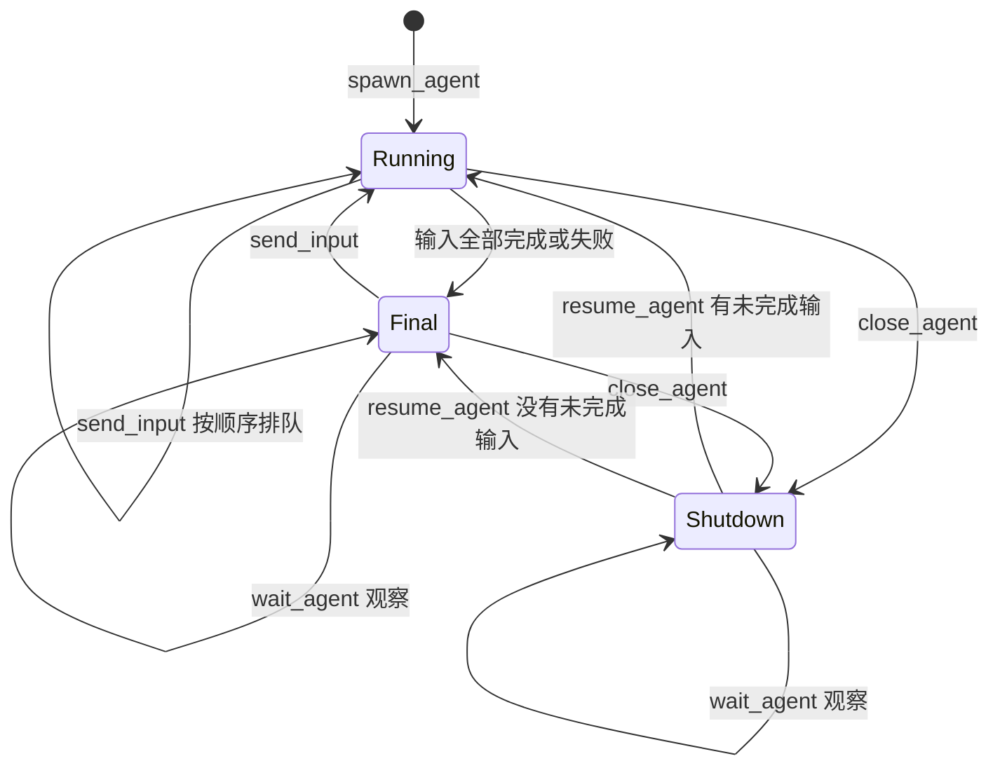

# 子 Agent 生命周期

主 Agent 通过模型原生 function calling 调用 `spawn_agent`、`send_input`、`wait_agent`、`close_agent` 和 `resume_agent`。runtime 执行每次调用，将结果关联到原来的 `call_id`，再交回主 Agent。各厂商的工具消息格式由模型请求模块转换。

## 编号和归属

| 字段 | 含义 |
| --- | --- |
| `session_id` | 用户的画布会话，拥有独立文档、对话和 Agent |
| `task_id` | 用户某条对话指令的执行任务 |
| `agent_id` | 可跨多条指令复用的子 Agent 会话 |
| `input_id` | 派发给某个子 Agent 的一条输入 |
| `run_id` | 该输入的执行记录，关闭和恢复沿用这个编号 |
| `call_id` | 一次模型工具调用；对应一个结构化返回 |
| `result_id` | 保存的绘图结果，供主 Agent 审核、提交或拒绝 |

每个子 Agent 只属于一个画布会话。输入、执行记录和绘图结果都会检查归属，其他画布不能引用这些编号。主 Agent 与子 Agent 使用本次任务开始时的同一份模型配置和 API Key，消息及上下文分别管理。

## 工具

| 工具 | 参数 | 行为 |
| --- | --- | --- |
| `spawn_agent` | `message`、可选 `nickname`、`relevant_ids` | 创建子 Agent，立即开始执行，返回身份、状态、输入和执行编号 |
| `send_input` | `agent_id`、`message`、可选 `relevant_ids` | 复用原会话；运行期间的新输入按到达顺序排队 |
| `wait_agent` | `ids`、可选 `after` | 等待任意指定 Agent 完成一次执行，或观察到 Final/Shutdown；返回摘要、结果编号和状态版本 |
| `close_agent` | `agent_id` | 停止执行，保留上下文、排队输入、工具检查点和已准备动作 |
| `resume_agent` | `agent_id` | 使用原身份恢复未完成工作；没有待处理输入时进入 Final |
| `apply_agent_result` | `result_id` | 主 Agent 接受结果，执行器依次提交尚未提交的动作 |
| `reject_agent_result` | `result_id`、`reason` | 主 Agent 拒绝未提交部分，并保存原因；已提交内容保留在画布 |

子 Agent 只具有 `create_elements`、`create_element`、`select_elements`、`move_elements`、`update_elements`、`delete_elements` 和 `inspect_scene`。工具名称与参数在每次执行前校验，子 Agent 无法创建或控制其他 Agent。

画布概况保留近期对象和选择状态。`inspect_scene` 支持按 `ids` 读取指定对象，也支持 `query` 搜索全部对象的名称和文字，因此较早的图形可以继续被定位和修改。

调用与返回记录示例：

```json
{
  "type": "function_call",
  "call_id": "call_x",
  "name": "spawn_agent",
  "arguments": "{\"message\":\"绘制左侧房屋\",\"nickname\":\"Hypatia\"}"
}
```

```json
{
  "type": "function_call_output",
  "call_id": "call_x",
  "output": "{\"agent_id\":\"agent_123\",\"nickname\":\"Hypatia\",\"state\":\"Running\",\"input_id\":\"input_456\",\"run_id\":\"run_789\"}"
}
```

同一个调用编号和相同参数重复送达时，返回已保存的结果。创建和输入编号根据调用编号生成，执行中断后重新处理也不会重复创建 Agent 或重复添加输入。相同调用编号携带不同参数会直接报错。

## 状态和排队



单个 Agent 只有一个执行协程，输入按数据库插入顺序处理。不同 Agent 的模型请求可以同时执行。`Final` 表示当前输入已处理，具体成功或失败由执行记录的 `status` 和 `error` 表示。

`wait_agent` 不会创建、恢复或重新执行任何工作。`after` 是各 Agent 上次返回的状态版本，用于读取新完成的执行结果。处于 Final 或 Shutdown 的 Agent 始终可以立即返回；继续等待其他工作时，使用返回的 `running_ids`，并仅携带这些编号对应的状态版本。

主 Agent 可以在一个结果完成后立即审核并提交，其余 Agent 继续准备。主 Agent 回复最终内容前，runtime 检查是否还有本任务的运行工作或待审核结果。运行工作需要完成或关闭，结果需要提交或明确拒绝。

## 私有上下文与绘图结果

SQLite 保存完整模型返回、工具参数、工具输出、私有画布和执行检查点。子 Agent 的下一轮上下文包括当前目标、前一次工作摘要、当前私有画布概况和近期完整工具交换。近期交换使用 48,000 字符的历史预算，较早的完整记录保存在数据库。

主 Agent 的每轮上下文包括最近对话、当前共享画布概况、子 Agent 状态和结果摘要。`task_progress` 从 SQLite 读取本任务已经派发的输入、已提交结果、拒绝原因和提交数量，保留准确的输入与结果编号。子 Agent 的画笔点列、完整动作列表和工具记录由 `result_id` 引用，提交时从 SQLite 读取。

主 Agent 自己的工具交换按完整的调用与返回保留在近期上下文，超过 48,000 字符的历史预算后移除较早的完整交换，完整记录仍在 SQLite。最近一轮保持完整，`task_progress` 持续保留已提交工作。这个预算用于管理模型上下文，任务和绘图动作继续执行。

同一个子 Agent 的后续输入可以引用前一次准备的对象。尚未提交的前置结果会进入它的私有画布，后续结果记录 `depends_on`。主 Agent 按依赖顺序接受并提交。当前共享画布与私有结果存在对象内容冲突时，执行器返回问题，主 Agent 可以要求修正。

## 关闭、恢复和提交进度

子 Agent 的模型返回在执行工具前保存。每次工具执行后，私有画布、动作列表及该 `call_id` 的返回在同一事务中保存。关闭发生在一次工具处理之后时，恢复会继续处理已保存返回中的其余调用；已经处理的调用读取原返回。

恢复时从该次执行的原始消息记录中读取近期完整工具交换，并恢复当前画布和检查点。子 Agent 可以保留此前创建、检查和修正对象的过程，继续完成同一条输入。

共享画布的每个动作和结果提交进度也在同一 SQLite 事务中写入。恢复提交会跳过已完成动作，移动和删除不会重复执行。每次正式修改仍经过对象内容检查、画布事件和撤销记录；画笔对象保留逐帧展示。

用户停止绘图任务时，属于该任务的运行子 Agent 会进入 Shutdown。服务重启会将中断任务标记为已停止，子 Agent 检查点保留；后续主 Agent 可以显式调用 `resume_agent`。任务和模型请求不设置执行期限，用户可以主动停止。

任何任务或子 Agent 仍在运行时，模型设置不能保存。删除画布前需要停止运行工作；删除在同一事务中清理所属 Agent、输入、执行、私有消息、工具调用和绘图结果。

## 验证

自动化测试使用实际 SQLite、原生绘图动作和 runtime，覆盖排队、观察、保存与恢复、提交幂等、对象冲突及会话隔离：

```bash
python -m pytest -q
```

生命周期评测从 `.env` 或 `DRAW_AGENT_*` 环境变量读取实际模型连接，创建独立测试数据库，检查并发请求、排队、关闭恢复和同一对象的后续编辑：

```bash
python -m scripts.evaluate_agent_lifecycle
```

启动使用独立数据库的服务后，可以检查主 Agent 自主调用工具完成组合绘图：

```bash
python -m scripts.evaluate_multiagent --url http://127.0.0.1:8001
```

结果和完整记录保存在 `runs/`，成功率和耗时按实际运行结果报告。
