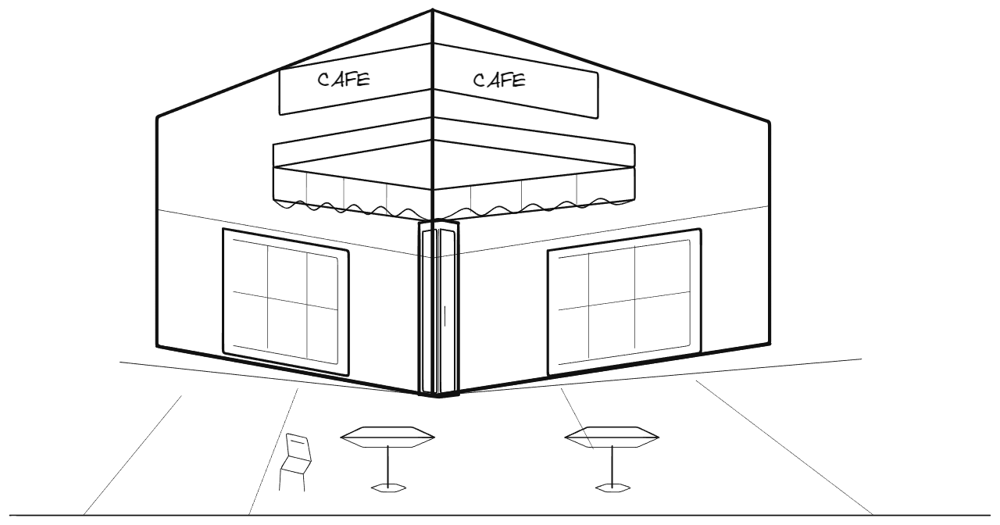
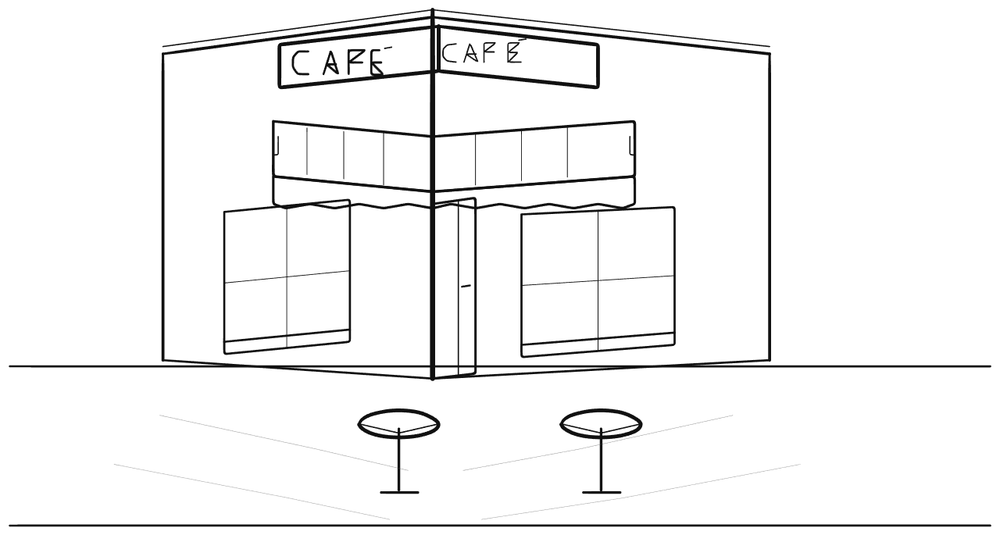

# 子 Agent 美术上下文与真实作画记录

本轮以 `1cf2d4903e343debefeec1ee31e482728ff14ab4` 为工程基线，修改子 Agent 的角色、当前对象表达、局部作画指导和失败交接。用户另外授权仅修改主 Agent 的完成判定，核查规划阶段与明确未完成事项，同时同步其完成规则段。主 Agent 的其他角色提示、派发协议、工具定义、绘图执行、存储、网络、模型配置与独立评审保持冻结。外层自动候选生成及版本晋级尚未实现；这里记录实际工程验证和样本结果。

## 整幅任务的完成核查

`studio/drawing_progress.py` 只读取当前任务实际保存的 DrawSpec、输入、已提交结果和完成报告。原始创作计划中的阶段按形体范围累计完成证据；局部输入可以共同完成阶段，一份报告也可以明确检查多个已完成阶段。子 Agent 的检查属于作画者自述，最终仍须通过原有整幅图片评审。

每个阶段保留原始标准。未完成阶段、明确未解决事项、未解决约束和缺少当前原生绑定的形体会返回主 Agent，要求通过已有 `send_input` 等工具继续处理。后续独立草稿检查通过、提交完成且范围包含对应形体的报告可以关闭较早待办；未解决的具名约束需要后续明确检查。无动作的完成报告必须对应当前共享图片。遭拒绝、尚未提交或其他构图版本的候选不提供完成证据。

核查只在本任务确实派发过原始整幅 `execute/block_in` 时启用。后续任务中的精确移动、改色、擦除、选择和研究继续按本次要求完成，不继承此前整幅创作的阶段要求。每轮主 Agent 上下文在原有图片评审之后附加当前计划完成状态，并持续指出原任务尚未完成的阶段。评审原始结论、五个维度、证据和错误逐字段保留；原计划尚未完成时，由完成策略提供继续原任务的结束指导，替代应用原先通用的“通过后尽快结束”指令。用户取消、工具错误、当前图片查看及原有独立评审继续使用现有机制。完成核查在评审之前及返回成功之前执行，不增加固定动作、轮次或耗时要求。

这处主 Agent 变更属于用户明确授权的工程修复。自动候选仍仅限子 Agent harness；不得把整个 `runtime.py`、独立评审或完成核查列入自动可改范围。边界核查比较 Python AST：`runtime.py` 除 `_complete_task`、对应导入及末尾完成状态送达语句外保持原样，`prompts.py` 除 `CHILD_SYSTEM` 和 `MAIN_SYSTEM` 的完成规则段外保持原样，`agent_manager.py` 除 `_execute_run` 外保持原样；其余冻结源文件逐项比较内容摘要。

真实提前结束样本保存于 `runs/cafe-art-runtime-handoff-20261021`：25 个原生对象，约 145.65 秒结束，原计划 contour、detail 尚未执行，子 Agent 明确报告这些后续工作未完成。原有整幅评审仍返回通过。该样本用于完成核查回归，不作为画质或速度验收成功。另一份实际咖啡馆报告在 contour 输入中同时检查 detail，新的核查允许这项已经完成的工作，无需新增一次绘画输入。两份原始记录的任务、提交、报告、当前原生编号、场景摘要和实际图片评审保存在 `tests/fixtures/drawing-progress-recorded-cafe.json`，用于核查状态和反馈传递。

## 当前上下文

`studio/child_art_context.py` 从完整原始 DrawSpec 提取当前阶段的工作顺序、视觉重点、明暗设计、形体范围与后续阶段。包围范围用于定位，最终轮廓需要表现具体形体。轮廓连接、遮挡、明暗形体与留白成立后，再发展纹理和局部特征。完整原始任务和构图继续保留。

当前对象索引集中提供真实编号、范围、角度、版本与原生样式。简短路径增加当前画布坐标中的中心线样本，包含已经执行的移动与旋转；它复用原有几何检索，允许的简化误差为一画布单位。较长路径继续通过既有检索取回。索引样式编号只属于当前上下文，持续笔记保存实际属性值。可以由索引逐字段完整恢复的前缀元数据使用编号引用，额外几何、工具返回和错误继续保留原值。

具有灭点的建筑构图还提供原有结构标志点向灭点投影的数值参考。评审中的几何建议需要同当前原生轮廓、实际图片和原始构图核查。对象名称、动作数量和一次工具成功均不代表画面正确。

整幅查看用于请求已构造修复的复核；局部查看用于具体部位的观察。普通 `repair` 在当前输入继续。原有独立比较确认实际纠正无效，并形成 `ineffective_repair` 时，runtime 通过已有结果机制交回草稿、失败方法和未解决问题，由主 Agent 调整输入。交接标记为 `source=independent_draft_comparison`，不生成子 Agent 自述报告，不需要额外模型调用。该候选保持未获批准，未读错误继续完整送达。没有增加动作、轮次或时间限制。

## 当前实现的真实验收

提示为“画一幅街角咖啡馆的透视线描，包含遮阳篷、门窗、店招和门口的两张桌子。”使用现有 Ark `ark-code-latest` 及相同配置。空白画布测试直接复用实际记录中的有效首次 DrawSpec 派发，SHA-256 为 `95d6a3fc7e6f84a03032bd9e2bed02c3c1c17e80c27f040ce42bc32e27ec6007`，随后由当前 Agent 自行作画、派发、提交和结束。该测试不包含主 Agent 首次生成构图的耗时。

续画测试从只读保存的真实未完成状态开始，保留同一个 Agent、输入和已有原生动作。原始数据库及暂停前的图片、原生文件和上下文继续保存。续画用时只表示恢复后的这个执行区间，原任务时间戳和较早画布更新不能作为空白画布延迟。

| 项目 | 空白画布测试 | 已保存草稿续画 |
| --- | --- | --- |
| 运行目录 | `runs/cafe-plan-full-20261021` | `runs/cafe-completion-policy-20261021` |
| 自然完成 | 是 | 是 |
| 最终原生对象 | 63 | 59 |
| 任务执行用时 | 720.65 秒，约 12 分钟 | 1269.95 秒；恢复区间为 1272.18 秒 |
| 首个共享画布更新 | 480.72 秒，约 8 分钟 | 继承已有画布，不作空白画布比较 |
| 本次模型调用 | 43 | 112 |
| 未收到最终回复的调用 | 0 | 0 |
| 本次工具错误 | 0 | 4；另有 2 份已经送达的历史错误 |
| 最终计划完成状态 | 无未完成阶段、无未解决报告 | 无未完成阶段、无未解决报告 |
| 原有结构检查及五维整幅评审 | 通过 | 通过 |
| 人工美术验收 | 等待人工判断 | 等待人工判断 |

两项实测存在时间重叠，不能用于断言速度改善或稳定的平均耗时。空白画布测试还保留一次整幅评审格式错误及原始回复，后续画面重新评审通过；工具错误与评审格式错误分别记录。首次画布更新约 8 分钟，仍未达到低延迟目标。

空白画布测试只有两个子 Agent 输入，分别使用 block-in 和 contour；后一输入明确检查了已经可见的 detail，完成核查允许这项跨阶段证据。续画测试也逐项完成了原定三个阶段。整幅评审通过时，主 Agent 仍接收准确的计划状态；确认阶段及报告均已处理后才结束。

[原生可编辑文件](assets/cafe-plan-full-20261021.excalidraw)和[派发、源码摘要、完整评审与完成核查证据](assets/cafe-plan-full-20261021.json)。

[续画原生文件](assets/cafe-completion-policy-20261021.excalidraw)和[续画来源、时间范围、评审与完成核查证据](assets/cafe-completion-policy-20261021.json)。这些图片直接由最终共享原生文档导出，保留可编辑对象，不使用另行制作的效果图。

逐轮重放核查了空白画布测试的 26 份子 Agent 输入、1,526 条当前对象记录、1,464 条简短路径和 43 张当前草稿图片；续画核查覆盖 75 份子 Agent 输入、3,660 条对象记录、3,082 条简短路径和 106 张图片。索引坐标、版本、样式与实际原生状态比较，图片与对应观察记录及场景哈希比较，原始任务保持一致；完整调用配对检查没有发现问题。续画中的 4 份新工具错误均完整送达后续上下文。检查证明上下文与实际草稿一致，不能代替美术判断。

空白画布测试的模型调用时间区间并集为 622.88 秒，另有 97.50 秒位于模型调用区间之外。子 Agent 26 次调用累计 394.51 秒，主 Agent 7 次累计 62.23 秒，草稿评审 6 次累计 117.69 秒，整幅描述与评审 4 次累计 55.78 秒。部分调用重叠，`wait_agent` 也包含子 Agent 工作，不能重复加入总用时。渲染、提交和调度尚未逐函数独立计时。

两项测试的完整上下文均位于相应目录的 `contexts/index.html`；`context-verification.json`、`plan-completion-verification.json`、`runtime-provenance.json` 和源码快照保留实际证据。空白画布目录还保存 `memory-trajectory.json`、`content-projection.json` 与 `timing.json`。

## 其他真实记录及限制

重复局部修复的实验保留在 `runs/cafe-art-policy-20261021/operator-checkpoint` 和 `runs/landscape-art-policy-continuation-20261021/operator-checkpoint`。它们由操作者停止，未获完整作品验收，不计入成功率或完成耗时改善；没有将实验停止条件加入产品。

完成规则及上下文送达顺序的中间测试保留在 `runs/cafe-plan-continuation-20261021`、`runs/cafe-plan-aligned-20261021`、`runs/cafe-erasure-completion-20261021` 和 `runs/cafe-completion-context-20261021`。这些运行由操作者停止，包含保存时尚未结束的模型请求，不计作自然完成样本。较早的 50 对象对照及其源码保存在 `runs/cafe-art-handoff-20261021`。

从空白画布自然派发的山水样本保留在 `runs/landscape-art-facts-20261021/operator-checkpoint`。其中 16 次模型调用包含 3 次输出截断和多次构图参数错误，尚未成功启动子 Agent。它反映冻结主 Agent 的实际派发问题，不能归因于尚未执行的子 Agent，也不能把复用有效派发的控制运行称为此路径已经修复。

当前上下文还存在可精简内容。一份实际输入含 40,118 prompt tokens；其中原始 DrawSpec 约 10,287 字符、美术执行指导约 7,362 字符、当前对象索引约 19,941 字符。按实际首次送达时间重放已有归档，额外归档三份已送达工具回执只减少约 2,982 字符，说明现有工具压缩正在工作。后续精简需要保留作画内容、当前几何和错误证据，并经过真实作画比较。

当前延迟还包含 block-in 阶段的桌椅反复修改。该阶段的实际草稿评审曾按完成稿要求店招文字、门扇和座椅；需要持续核对当前阶段、原始要求与评审范围。原有评审和首次构图生成保持冻结，本轮没有修改这些部分。跨题材画质、首次更新等待与完整耗时继续由 [GitHub Issue #44](https://github.com/bugkeep/ai-draw/issues/44) 跟踪。

## 检查与复现

`python -m pytest -q --basetemp runs/pytest-completion-policy-full-20261021`：298 项通过，78.27 秒。新增检查使用真实原生对象、实际 SQLite 与渲染器，并回放实际未完成与跨阶段完成记录；实际擦除后的整幅查看会生成复核检查点。图片评审与计划完成状态的送达检查逐字段核对原始评审结论，局部任务继续保留原范围。真实反馈记录用于检查路由和完整错误传递，没有生成模拟模型回复。

实际作画使用独立数据库，通过现有 `scripts.inspect_agent_contexts` 保存模型输入与回复，完成后由 `scripts.evaluate_quality --recheck` 读取原有结果、导出实际画布。保持原始数据集和独立评审，不能将取消、局部通过或模型自述作为整幅作品通过。需要对多题材重复运行，并将人工画质判断同自动结果分别记录。
