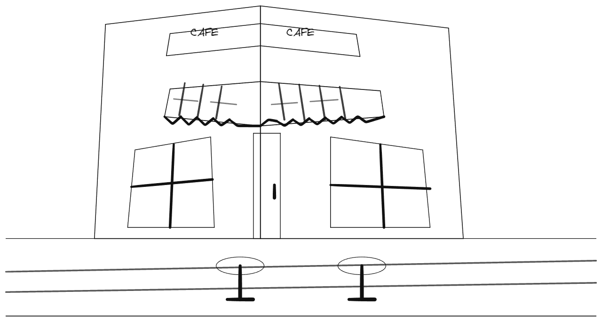

# 子 Agent 持续作画记忆验证

机制检查和真实绘画分别验证。真实任务使用原有主 Agent、原生绘图工具、模型连接和独立评审；对象数量、工具成功、步骤笔记均不作为画面完成的依据。

## 机制检查

```powershell
python -m pytest tests/test_child_drawing_memory.py -q
python -m pytest tests -q
```

持续记忆与当前子 Agent loop 的完整后端检查为280项通过。新增检查使用真实SQLite和原生对象，覆盖当前输入恢复、输入/Agent/画布隔离、删除编号、原始几何检索、完整工具错误、已送达评审、图片坐标单位、样式继承、图层顺序、当前位移和笔记调用归属。历史评审记录仅用于验证记忆传递，没有用于给新画面评分。

## 真实作品记录

使用现有Ark的ark-code-latest配置，从空白会话提交冻结数据集的street-cafe原样提示：

> 画一幅街角咖啡馆的透视线描，包含遮阳篷、门窗、店招和门口的两张桌子。

主Agent自主建立构图、派单、检查和提交。子Agent完成起形后继续detail输入，工作笔记从revision0更新到7。新输入第一轮把旧笔记标为历史，随后使用本输入标签保存当前步骤。实际步骤包括门框与人行道连接、桌面和支杆连接、被白色mask遮挡的CAFÉ文字，以及辅助线清理。

最终任务自然completed，共61个原生对象，原有结构检查、主Agent最终共享图片查看和独立整幅视觉评审均通过。60次实际模型请求全部有回复，其中27次子Agent请求。7次工具错误及2次报告错误完整保留并反馈。每次步骤焦点都与附图的实际scene_hash一致。

总耗时约22分07秒，首个共享更新约10分20秒，延迟仍需改进。这是单次完整作品记录，没有据此计算普遍成功率或宣称性能提升。同期人物头部修复和固定构图猫图回归存在未完成结果，均保留为负例；该版本尚未证明可以稳定完成高质量人物素描。

## 子 Agent loop 验证条件

[调用与耗时检查](child-loop-latency.md)记录上述60次请求的时间区间、具体笔记保存、查询、无效构造、报告校验及中间评审。后续实验继续冻结主 Agent、模型、工具、绘图执行、存储、网络和全部评估实现。

仅调整评审检查点的首次复测在约9分07秒由操作者结束，35次请求中1次未返回，私有草稿准备63个动作，共享画布仍为空。该运行在桌椅位置修正与读取之间反复进行，没有获得整幅通过，不能作为提速证据。源码、完整上下文、实际私稿、原生文件和只读检查点均保留。

增加当前原生坐标、实际位移、历史评审待办和笔记调用归属后，一次从空白启动的测试在约6分20秒结束，未进入子任务；6次主 Agent 请求中1次未返回，并发生提供方输出截断与无效JSON。该结果用于记录冻结主 Agent 的派单耗时，不能判断新版子 Agent 的画质。

为直接检查子 Agent，固定构图复测使用原22分钟运行中主 Agent 已验证的完整原始 assignment。画布重新创建，所有模型请求、绘图与后续主 Agent 行为实际执行，没有模拟模型回复；后续提交和整幅评审保持原样。固定构图结果单独记录，不作为从空白自主规划的端到端耗时。

固定构图复测自然完成，共70个原生对象，原有结构检查、主 Agent 最终图片查看及独立整幅评审全部通过。14次模型请求全部保存完整回复，其中7次子 Agent 请求、1次私有草稿评审。首次调用中1个无效JSON工具错误完整进入后续上下文；随后使用原生几何工具继续，没有删除重画，绘图报告没有校验错误。笔记保存1次，场景查询与画布查看各1次。

| 指标 | 原运行 | 固定同一构图的复测 |
| --- | ---: | ---: |
| 有效派单后至整幅完成 | 18分40.58秒 | 4分40.35秒 |
| 首个子任务执行 | 6分40.85秒 | 3分44.51秒 |
| 子 Agent 模型请求 | 27 | 7 |
| 私有草稿评审请求 | 12 | 1 |
| 子 Agent 绘图工具错误 | 7 | 1 |
| 绘图报告错误 | 2 | 0 |

该次有效派单后的耗时减少约75%。原运行总计22分06.67秒，其中约3分26.09秒用于有效派单前的主 Agent 请求；这部分保持冻结。复测没有重新生成初始构图，两次运行的模型输出和机器负载也可能变化，因此该结果只说明本次固定输入的表现。全部冻结运行文件经换行规范化后一致，评测数据的语义内容一致；原数据文件使用CRLF，当前文件使用LF。

完整评审仍指出遮阳篷内部线条较多、道路线经过桌面，自动评审认为主体可读并通过。本记录不代表人工美术质量验收。[机器可读证据](assets/cafe-child-loop-20261021.json)与实际输出如下：



## 复现整幅验收

按[部署说明](deployment.md)准备模型连接和前端渲染环境。在独立数据库启动服务：

```powershell
$env:DRAW_AGENT_DB = "runs/memory-quality.sqlite3"
python -m uvicorn server.app:create_app --factory --host 127.0.0.1 --port 8031
```

为该实例配置模型后，在另一个终端运行冻结评测程序：

```powershell
python -m scripts.evaluate_quality --url http://127.0.0.1:8031 --cases street-cafe --output-dir runs/memory-quality-results
```

该命令调用实际模型，并保存最终共享画布的PNG、可编辑.excalidraw及评审JSON。检查任务状态、全部结构条件、最终图片查看和独立视觉评审，阅读图片与评审原文。固定模型配置和数据集有助于比较，单次结果仍会受到模型输出与运行环境影响。

完整请求与回复的捕获、图片和工具参数检查见[上下文检查](context-inspection.md)。检查内容包括共同构图、当前具体步骤、形体比例与连接、遮挡、保护对象、实际回执、完整错误和持续记忆；笔记中的计划与已经执行的操作分别核对。
