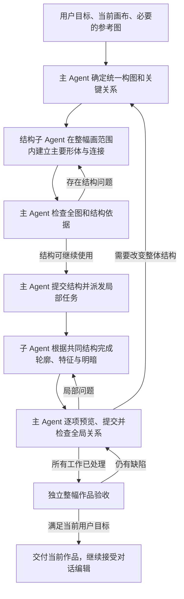

# 整幅画的构图、比例与连接关系

状态：2026-10-20 的归因记录与设计。主 Agent 通过现有派单工具传递共同构图的受控实现正在独立数据库中验证，尚未选择为运行基线。当前选定的运行代码仍为 `9ab01ff717e4705bd8cd4bdad8406cc8ebacbc13`。未获得画面质量收益的图层提示与恢复候选保存在独立实验目录，没有进入运行代码。

目标是让连续作画围绕同一幅画的整体结构推进。人物、动物、山水和流程图均先确定整体布局与关键关系，再逐步完成局部。原生 Excalidraw 对象继续承担最终作品、选择、修改、擦除和撤销重做。

## 已确认的原因

本轮只读复核真实模型执行记录与原生画面，没有启动新一轮模型绘图，没有修改用户作品数据库。

| 部分 | 实际证据 | 能得到的结论 |
| --- | --- | --- |
| 主 Agent 派单 | `blank-cat-selected-20261020` 的用户请求是窗台上的蜷睡猫与窗外树枝。首次派单包含整场景的轮廓和细节，后续逐步增加了全部猫轮廓必须缩进左下窗格并避开窗框的要求。 | 有整体边界的文字提示，但缺少持续使用的主体尺寸、支撑点、连接与遮挡定义。返修过程中构图限制发生变化。 |
| 主 Agent 恢复 | 同一任务在仍有两个未拒绝的依赖结果时，先向子 Agent 发送“忽略私有链、从共享画布重做”。新输入因旧依赖与共享画布冲突而失败，之后主 Agent 才拒绝剩余结果。 | 文字上的放弃不能代替实际的结果状态操作。任务恢复顺序存在可验证的问题。 |
| 子 Agent 作画 | 同一初始草稿的基线继续执行新增 30 个原生动作，最终仍为 `blocked`。另一个候选恢复了猫形后，把白色遮罩单独移到最前，盖住尾巴、五官和爪子。 | 子 Agent 没有稳定维持结构、局部细节和图层关系。增加调用次数或补充提示尚未形成质量收益。 |
| 视觉交付 | 对两个实验的 8 个真实请求逐项核对，8 张全图与 4 张带坐标辅助线的局部图均与当前原生场景一致，实际图片内容出现在模型请求中。 | 这些实验不存在“只保存截图、没有发送图片”的问题；图片交付不能证明模型准确理解了空间关系。 |
| 工具与渲染 | 原生 `draw_paths`、透明描边闭合填充、闭合 line 与 ellipse 的控制实验均能用白色填充遮住后方线条。 | 已验证的遮挡失败不能归因为白色填充不可用。其他工具能力仍应分别验证。 |
| 局部结束策略 | 草稿评审比较出一次有绘图操作的修复无效或退步后，当前策略会要求子 Agent 无工具调用地交回主 Agent。 | 局部循环可能在仍可进一步修复时转交；整体恢复依赖主 Agent 正确接续。它不是总调用次数限制。 |
| 评审可靠性 | 在固定的单独图层任务中，子 Agent 调用 `reorder_elements(position=back)`，把白色遮罩放到所有背景之前。窗格线在原生顺序和实际 PNG 中均穿过猫身，草稿评审仍返回 `ready` 并声称窗线已被遮住。 | 当前评审存在明确的通过误判。局部任务结束更快、评审通过都不足以证明作画质量提高。 |
| 最终任务状态 | 上述整场景任务首次共享画布更新约 468.5 秒，结束约 598.1 秒。全图评审通过后，历史上的一次失败输入仍让任务标记为 `partial`。 | 历史执行失败与当前作品是否完成混在一个状态里；状态缺陷和美术质量需要分别归因。 |

当前证据支持优先处理整体结构管理、局部执行与恢复、评审可信度。尚未进行只改变模型、其余条件相同的对照，不能据此认定主模型或子模型的能力上限。

复核产物位于本地忽略目录 `runs/drawing-process-diagnosis-20261020/`：`main-task-timeline.json`、`child-replays.json`、`vision-and-handoff.json`、`layer-review-false-positive.json`，以及生成这些记录的只读脚本 `runs/diagnose_drawing_process_20261020.py`。图层案例的前后原生文件与 PNG 保存在 `runs/layer-order-baseline-20261020/`。这些文件是实验记录，不作为已实现的新运行机制。

## 全局作画依据

主 Agent 持有唯一、带版本的 `composition`。它描述本幅作品整体结构；每个子 Agent 接到的任务引用同一个版本。子 Agent 可以提出结构修订，主 Agent 决定是否采用并发布新版本。

需要持久保存以下信息，完整数据留在 SQLite，上下文只包含当前任务需要的部分：

| 数据 | 含义 |
| --- | --- |
| `composition_id`、`revision`、`document_id`、`based_on_version` | 标识构图、画布与依据的文档状态，隔离不同作品和后续修订。 |
| `frame`、`reference_layout_id` | 统一画布坐标与画幅比例；有参考图时复用现有主 Agent 定义的源图映射。自动缩放的截图范围不重新定义构图。 |
| `subjects` | 主体与背景区域、尺寸、朝向、整体姿态、视觉重心和已有对象 ID。轮廓完成前允许使用明确标记的近似形体。 |
| `landmarks` | 关键连接位置和方向，例如肩、肘、腕、下颌、猫爪接触窗台的位置、河道转弯和连接线端口。位置使用共同的画布坐标。 |
| `proportions` | 当前参考或画风所需的相对尺寸与间距。不同画风采用相应依据，不给全部人物固定同一套比例。 |
| `relations` | `attached_to`、`supported_by`、`in_front_of`、`behind`、`continuous_with` 等结构关系，以及对应对象与连接位置。 |
| `preserve`、`unresolved` | 用户明确要求保留的内容、尚未确定的结构、需要确认的参考依据。主 Agent 自选的构图决定和用户硬性要求分别记录。 |
| `phase`、`evidence` | 当前作画阶段、已提交的原生对象和对应当前图片证据。对象存在、工具成功或 Agent 自述都不等于视觉验收。 |

例如，窗台猫至少需要保持 `cat.paws supported_by sill.top`、`cat.head attached_to cat.body`、`cat.tail continuous_with cat.body`、`branch behind cat.silhouette`。单独列出“头、耳、身体、尾巴都已经画了”无法表达这些要求。

现有 `reference_layouts.py` 已提供共用的源图到画布映射，可继续使用；它目前没有定义关节连接、支撑、相对尺寸或作画阶段。提示词目前也已要求考虑比例和连接，但没有足够的持续状态与执行约束保证后续修改遵守。

## 作画与检查过程

1. **先形成整幅画的结构。** 结构子 Agent 的任务覆盖整幅画，表达主体轮廓、姿态、主要形体、关键连接和前后层次。此时不追求毛发、睫毛、衣纹等局部完成度。绘画工具继续使用现有 `draw_paths`、`reshape_path`、原生形状、移动、擦除和图层操作。平滑曲线只能改善曲线外观，身体结构仍需单独建立。
2. **检查结构后提交可见进展。** 主 Agent 同时查看整幅原生 PNG 和 `composition`，检查主体大小、姿态、连接、支撑与遮挡。结构阶段按当前任务检查结构，最终作品依然接受完整质量验收。确认可使用的结构通过现有结果提交机制进入共享画布，用户可以看到作画推进。
3. **局部任务引用整体结构。** 每条输入携带同一构图版本、当前局部对象、需要保留的相邻连接和可验证的完成要求。子 Agent 同时保留全图与必要局部图，修改局部后检查相邻关系。手臂位置改变时，肩、肘、腕和手部不能各自独立解释。
4. **按依赖安排并发。** 结构确定后，背景纹理与已确定位置的主体特征可以并行准备。共享关节、轮廓或遮挡顺序的任务表达依赖，由主 Agent按文档版本提交。头部、躯干、双手尚未建立共同连接时，不同时让多个子 Agent各自决定姿态。
5. **整体变化产生新版本。** 用户提出改变人物姿势、主体位置或整体比例时，主 Agent 修改构图版本，找出受影响对象与待提交结果。局部颜色、文字等修改可保留构图版本。旧任务结果不能直接覆盖新结构，已有有用内容继续复用。
6. **辅助结构有明确归属。** 如果结构阶段绘制辅助线，标明相应对象 ID 和用途，后续重画、替换或删除这些对象；交付前确认辅助线已按目标处理。相应动作继续保留正常撤销重做。不能把大量重复描线当作结构完善。

子 Agent 返回的结构化摘要包含所用构图版本、原生结果引用、已修改对象、已处理关系、当前图片证据和未解决事项。完整工具日志与几何继续留在 SQLite，主 Agent 按需检索。

### 通过现有工具同步消息

主 Agent 使用现有 `spawn_agent`、`send_input` 和 `wait_agent` 协调绘图，通信内容采用 [DrawSpec/1 美术 DSL](drawspec.md)。首次派单的 `drawspec.composition` 参数保存媒介与完成要求、动态线、主要形体、结构标志点、比例、支撑与遮挡以及完整阶段计划；后续消息使用 `composition_ref` 引用当前构图 ID，只发送局部目标、阶段和完成要求。运行时解析同一画布内的引用，把完整快照与局部目标一起保存到既有 `agent_inputs.message`，不增加消息队列或数据库表。子 Agent 从自己的输入读取固定快照，主 Agent 的上下文只投影当前构图。实际模型请求记录包含输入、执行、构图与阶段编号，可与对应模型响应核对。

`send_input` 返回 `input_id`、`run_id` 和队列状态，表示输入已经接收。Running 子 Agent 继续处理原输入，新消息按到达顺序排队；收到消息不会修改正在执行的输入。主 Agent 通过 `wait_agent` 取得相应输入的结果，预览后决定提交、继续返修或放弃。

同一构图版本要求内容一致，更新版本前处理当前运行任务与待提交结果。进入起形之后的执行阶段前需要已经提交起形；未提交起形的 `intent=repair` 继续发送给保留该私有候选的同一子 Agent，无需为允许返修而先提交错误结构。暂停后恢复的旧版本结果不能覆盖新构图。

当前已验证消息排队、快照隔离、结构提交条件、私有返修、恢复后的版本保护、参考图独立交付和数据库持久化。真实绘图仍有待解决的形体与连接问题；通信与状态检查通过不能作为画面质量达标的证据。

## 适用于不同题材的结构

| 题材 | 整体阶段首先建立的内容 | 局部阶段持续保持的关系 |
| --- | --- | --- |
| 人物与肖像 | 头部朝向、胸廓与骨盆、肩线、手臂姿态、手部位置、主要外轮廓。 | 头颈肩连接，肩肘腕连续，双手相互遮挡，五官服从头部朝向。 |
| 动物 | 躯干与头部形体、脊线、四肢支撑、尾巴走向。 | 肢体与躯干连接，脚爪接触支撑面，尾巴环绕与前后遮挡。 |
| 山水与风景 | 地平线、近中远景主要形体、河道与道路走向、主体与留白。 | 空间层次、山体遮挡、河道连续、树木尺度与地形关系。 |
| 流程与结构图 | 节点层级、相对位置、阅读顺序与连接端口。 | 连接到正确节点与边界，避免错误交叉，保持文字可读。 |

这些内容根据目标选择使用。系统不强迫全部题材采用人物作画步骤，也不为某一个提示词保存固定成品模板。

## 验证与工程边界

整幅构图与共用连接定义涉及主 Agent 的派单和状态管理，属于受控的架构变更。当前文档没有解除 `harness-evolution.md` 记录的冻结边界，也没有把主 Agent、工具、SQLite 或评审加入子 Agent 自动演进范围。实施相关架构变更后，需要独立验证并建立新基线；之后自动候选依然只修改子 Agent 执行 harness。

评审通过误判要作为独立工程问题处理。不能让候选修改评审提示、接受条件或版本选择规则来得到更高分数。建立新的评审基线时，保留上述真实误判案例，并结合原生关系与实际图片检查；数值或关系检查也不能替代对人物形态和整体美术质量的视觉判断。

比较机制是否有效时，需要固定相同的用户目标、初始画布、参考图、模型与验收条件，分别记录：

- 结构阶段的整体比例、姿态、支撑、连接与遮挡是否正确。
- 局部细化和连续修改是否保留这些关系，用户要求的变更是否正确传播。
- 人物、动物、山水和流程图的整幅作品验收情况，包含未针对性调试的提示。
- 实际原生结果与图片，不用动作数、组件数或 Agent 自述代替完成质量。
- 首次可见结构、完成验收所需时间、模型请求和上下文消耗。额外规划成本计入总耗时。
- 独立评审的通过误判、实际工具错误、任务恢复与用户作品保留情况。

只有整体质量和后续编辑同时得到改善，才能认为这套机制产生了收益。目前尚无此项实现后的验收结果。
